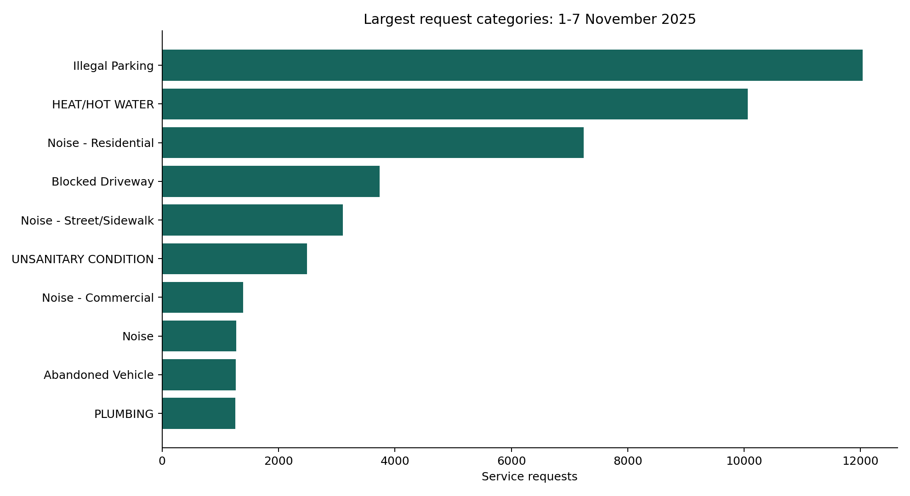
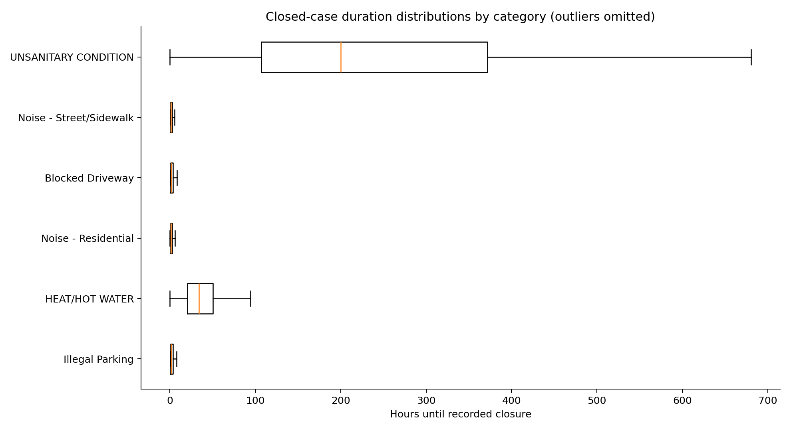
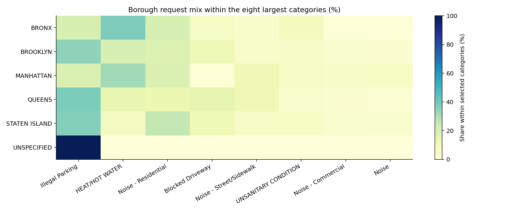

# NYC service-request analysis

A Pandas and Matplotlib review of request volume, category mix and recorded closure times. The operational question is which request categories drive workload, and whether a borough comparison changes when request mix is visible.

The included public snapshot contains **72,494 requests created during 1-7 November 2025**, spanning **154 request categories**. It is the complete API-query cohort, checked against a separate source count, rather than the first rows of a larger sample.

## Visuals







## Findings

At the fixed 1 December 2025 cutoff, 65,460 requests have a valid recorded closure. Their median closure time is 6.10 hours. Another 7,034 requests have no valid closure before the cutoff; this includes 80 negative timestamp intervals identified by the quality checks.

68.00% of all requests have a valid closure within 48 hours. **48 hours is a descriptive threshold, not an official service-level agreement.** Recorded closure is not proof that the underlying problem was resolved.

The closed-case median excludes open cases and is therefore not a complete measure of response performance. Category mix, reporting behaviour and agency processes differ, so the charts do not rank boroughs as better or worse services.

## Run

```sh
pip install -r requirements.txt
python analysis.py
python -m unittest discover -s tests -v
```

The frozen CSV is included, so this works offline. `python download_data.py` performs an explicit refresh and records a new source count and checksum. The public data changes, including historical records.

Open `outputs/report.html`, or use `exploration.ipynb`. Tests cover duplicate IDs, invalid created dates, negative closure intervals and the denominator for open/later-closed cases. GitHub Actions runs both the tests and the full analysis on the included snapshot.

## Definitions

- One row is one unique service request.
- A valid observed closure must be at or after creation and before 1 December 2025.
- Later closures and absent/invalid closure timestamps remain in the all-request denominator.
- Box plots use valid closed cases and omit displayed outliers. The summary CSV retains full-duration quantiles.
- The heatmap normalises within the eight largest selected categories in each borough, not all categories or resident population.
- Source exports omit addresses, coordinates, ZIP codes and free-text descriptions.

Code is MIT licensed. The NYC public dataset is attributed separately in `DATA_SOURCE.md`; the MIT license does not relicense city data.
